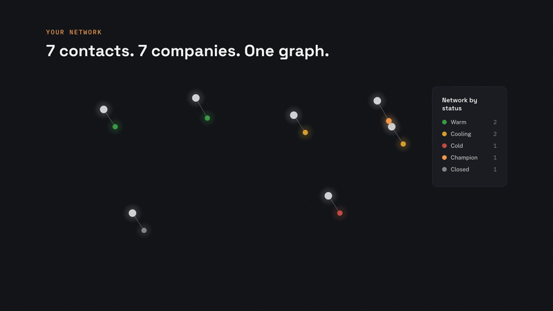
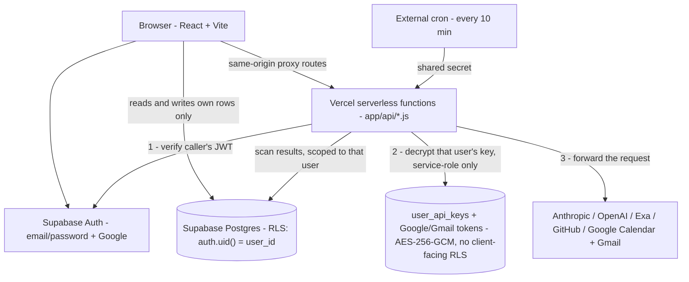

# Recruiting OS

A near zero-touch **recruiting operating system** for a student internship
search (SWE, PM, IB, quant, consulting): a CRM, application tracker, inbox
triage, interview prep and job-board aggregator with AI assistance, wrapped in a
**React** dashboard.



▶ [Watch with sound](https://ethansaba.com/videos/recruiter.mp4): built to read my own Gmail.

> **Multi-tenant, bring-your-own-key.** Sign up with email/password or Google,
> then add your own Anthropic/OpenAI/Exa/GitHub API keys in Settings. Your data
> (contacts, applications, interactions) lives in your own Supabase-backed
> account. Nobody else can see it, and you're never billed for anyone else's
> AI usage (or vice versa). Try it without signing up at `/demo` (sample data,
> nothing saved).

---

## What it does

Seven tabs, plus Settings:

- **Today**: a dashboard you arrange yourself. Metric cards (pipeline funnel, network
  warmth, weekly outreach, response/OA/interview/offer rates) over attention cards
  (replies drafted for you, AI action items from email, people to follow up with,
  stale applications and OA deadlines, campus events). Drag cards to reorder, resize
  them, and turn individual lists on or off.
- **Inbox**: your recruiting email grouped by thread, filtered to what needs a reply.
  When someone asks to talk, the scan **drafts a reply** with three open times from
  your call hours minus your calendar's busy blocks, informed by your résumé. Copy it
  into Gmail; nothing is ever sent from the app.
- **Network**: a contact CRM with status, urgency, follow-up dates, "referred by"
  links, table + card + force-directed graph views, and an interaction ledger. A
  "Keep in Touch" reconnect queue, and a one-click **LinkedIn connections import**.
- **Grow**: find companies (YC directory + Exa search, AI-ranked), see where you have
  no warm contacts, then find people there from Exa's public-web search (never scrapes
  or logs into LinkedIn) and draft the intro.
- **Learn**: interview prep per track (SWE, PM, IB, quant). A mastery model per topic,
  LeetCode sync with struggle detection, company-tagged problem lists, a spaced-
  repetition re-solve queue, practice import, and an AI coach that grades your
  explanations without handing you the answer.
- **Pipeline**: one row per application on a stage board or a keyboard-editable
  spreadsheet (Excel/CSV export, **import your existing tracker**), stage history from
  a database trigger, a Sankey of where applications went, and a job-board aggregator
  for GitHub internship lists with per-job AI fit analysis and deadline extraction from
  the real apply page.
- **Calendar**: two Google Calendar slots (personal + school), a dedicated Recruiting
  calendar, your campus's career fairs and info sessions ranked by relevance, conflict
  checks, and "+ Event" from a screenshot via Claude vision.

Under it all, a **Gmail scan** reads every mailbox you connect (read-only), classifies
recruiting and networking email with your own AI key, and keeps contacts, applications
and action items current: confirmations create the application, interview and offer
emails advance it (only for applications you've actually sent), and calendar invites
supply the real interview time. Optional phone pushes via ntfy.

A guided onboarding imports what you already have, so the app is useful before you
connect anything or paste a key.

---

## Architecture

The browser never holds an API key. Every third-party call is proxied through a serverless
function that verifies the caller's JWT, then decrypts *that user's* key server-side. The
Gmail scan runs on a cron with no browser at all, using the same per-user key lookup.



**Nobody's API key or data is ever visible to another user.** Row Level
Security policies scope every table read/write to `auth.uid() = user_id`;
`user_api_keys`, `google_calendar_tokens` and `gmail_tokens` have *no*
client-facing RLS policies at all; only server code holding the service-role
key can decrypt them, and only after verifying the caller's JWT names that
same user.

---

## Tech stack

| Layer | Tech |
|---|---|
| Dashboard | React 18 + Vite, Tailwind v4 (5 color schemes × light/dark) |
| Auth + data | Supabase (Postgres + Auth), Row Level Security |
| Tables / graph / charts | `@tanstack/react-table`, `react-force-graph-2d`, Recharts |
| Interaction | `motion`, `@dnd-kit` (Today's card editor) |
| Hosting | Vercel serverless functions (auth, key injection, Gmail scan) |
| AI | Claude (Anthropic) or OpenAI GPT, chosen per user; BYOK |
| Search | Exa (people/company discovery, deadline extraction) |
| Email + calendar | Gmail API and Google Calendar API, per-user OAuth |
| Learn | `ts-fsrs` (spaced repetition), LeetCode public GraphQL |
| Résumé | `pdfjs-dist`, in the browser; the file is never uploaded |
| Ops | Upstash Redis (per-user rate limits), Sentry (scrubbed, optional) |

---

## Repo structure

```
app/                         React + Vite dashboard (primary interface)
  src/
    App.jsx                  Root: /demo, else sign-in → onboarding → the tabs
    db.js                    Supabase data layer (+ an in-memory branch for /demo)
    demoData.js              Seed data for the public /demo route
    lib/                     Pure logic + hooks: ai.js (the one AI entry point),
                             attention.js (Today), inbox.js, availability.js (slot math),
                             trackerImport.js, learning/, ingest/ (campus event feeds)
    components/              One file per tab + modals; today/, import/, onboarding/,
                             learning/, events/, jobBoards/, charts/, ui/
  api/                       12 Vercel serverless functions
    _lib/                    Shared server code: keys + crypto, rate limits, the Gmail
                             scan (emailPipeline.js), reply drafts, ICS parsing, LLM client
    gmail.js                 Gmail OAuth, connect/disconnect, and the cron-driven scan
    keys.js                  BYOK key CRUD (encrypted, server-only)
    google-connect.js        Google Calendar OAuth
    claude-api.js / openai.js / exa.js / gh-api.js / google-calendar.js   Proxies
    events-*.js              Campus event ingestion and enrichment
  test/                      vitest suites, including a live cross-user RLS suite
supabase/migrations/         SQL schema + RLS policies (source of truth for the data model)
scripts/
  email-pipeline.js          Legacy single-user Apps Script pipeline (being retired)
  migrate-notion-to-supabase.js   One-time: pull an old Notion workspace into Supabase
docs/architecture/           Topic deep dives (auth, email, events, Learn, calendar, …)
```

See [`CLAUDE.md`](CLAUDE.md) for the technical overview and [`docs/architecture/`](docs/architecture/) for the deep dives.

---

## Setup

### 1. Supabase
Local dev (recommended to start):
```bash
supabase start   # from the repo root; prints your local API URL + anon/service_role keys
```
Or create a free project at <https://supabase.com> for production.

Apply the schema:
```bash
supabase db push   # against whichever project supabase link points at
```

### 2. Environment
```bash
cp .env.example .env
```
Fill in `VITE_SUPABASE_URL` / `VITE_SUPABASE_ANON_KEY` / `SUPABASE_URL` /
`SUPABASE_SERVICE_ROLE_KEY` from step 1's output, and generate a
`SECRET_ENCRYPTION_KEY` (command is in the `.env.example` comment).
`GOOGLE_CLIENT_ID`/`GOOGLE_CLIENT_SECRET` are optional: they enable Google
sign-in, Calendar and Gmail. Optional extras: `CRON_SECRET` (any long random
string; guards the Gmail scan), `KV_REST_API_URL`/`KV_REST_API_TOKEN` (Upstash
Redis; rate limiting is off without them) and `VITE_SENTRY_DSN`.

Everything else (Anthropic, OpenAI, Exa, GitHub) is BYOK, added per user in
the app's Settings, not in `.env`.

### 3. Dashboard (`app/`)
```bash
cd app
npm install
npm run dev          # http://localhost:3001, running the real api/*.js handlers
npm test             # vitest
```
Sign up, then add your API keys in **Settings**. Or skip all of it: `/demo`
runs every tab on sample data with no account and no backend calls.

Deploy to Vercel with the project **root directory set to `app/`**, and add
the same env vars as encrypted production environment variables.

### 4. Gmail scan (optional)
1. In Google Cloud, enable the Gmail API, add the `gmail.readonly` scope to
   the OAuth consent screen, and add `https://<your-domain>/api/gmail` (and
   `http://localhost:3001/api/gmail`) as authorized redirect URIs.
2. Point a free external cron (cron-job.org or similar) at
   `POST https://<your-domain>/api/gmail` every ~10 minutes, with the header
   `x-cron-secret: <CRON_SECRET>`. Vercel Hobby's own cron only runs daily.
3. In the app, Settings → **Connect another Gmail account**. **Scan now**
   runs one immediately.

### 5. Migrating from an existing Notion setup (optional)
If you're moving off an earlier single-tenant version of this app that used
Notion as the data store:
```bash
node scripts/migrate-notion-to-supabase.js you@example.com   # sign up in the app first
```
Requires `NOTION_API_KEY` + the `*_DB_ID` vars in `.env` (see
[`notion/schema.md`](notion/schema.md)). Safe to re-run: it replaces just
that user's rows each time.

---

## Notable decisions

**Multi-tenant BYOK, so the app costs nothing to run.** A single-tenant version would have
been far simpler, but it would mean either eating everyone's AI bill or shipping my key to
the browser. Instead each user brings their own key, encrypted at rest with AES-256-GCM in
a table that has *no* client-facing RLS policy at all: the browser cannot read it under
any query. Only server code holding the service-role key can decrypt, and only after
verifying the caller's JWT names that same user.

**Security lives in Postgres, not in application code.** Every user-data table enforces
`auth.uid() = user_id` as an RLS policy. A bug in a React component can't leak another
user's contacts, because the database refuses the read regardless of what the client asks
for.

**One AI switch instead of two integrations.** Every text-only AI call site goes through
`lib/ai.js` (and its server twin for the Gmail scan), so each user picks Claude or OpenAI
in Settings and no feature knows which one it's talking to. Provider outages and pricing
changes stop being code changes.

**Drafts, never sends.** The scan writes reply drafts into a table the browser can read but
not insert into, and Gmail access is read-only. The worst an AI mistake can do is suggest
a bad email you then don't copy.

**Interview emails only advance applications you've sent.** Info-session and club-event
calendar invites were getting classified as interviews, and a fuzzy company match then
created applications at Phone Screen or bumped job-board Wishlist rows up to it: 17 fake
interviews on one real account. Now an interview or offer signal only moves an open
application that's at least Applied, and the prompt says event invites are never interviews.

**PostgREST silently caps responses at 1000 rows.** `fetchApplications` looked correct and
worked fine, until an account crossed a thousand records and simply stopped seeing the
rest, with no error anywhere. It now paginates explicitly. Silent truncation is the worst
class of bug: the happy path never tells you.

**Vercel's zero-config catch-all routes only match one path segment.** `api/notion/[...path].js`
404s on deeper paths, which cost real debugging time. The fix was flat handlers with the
sub-path passed as a query param via `vercel.json` rewrites.

**`/demo` shares no code path with the real app.** It runs on in-memory seed data with no
Supabase session and no backend calls, so a public demo route can't become an accidental
read of live data.

## Security & privacy

- **Row Level Security everywhere.** Every user-data table enforces
  `auth.uid() = user_id` in Postgres itself, not just in application code.
- **BYOK keys and Google/Gmail refresh tokens are never exposed to the browser.**
  They're AES-256-GCM encrypted at rest, in tables with zero client-facing RLS
  policies; only server code holding the service-role key can decrypt them,
  and only after verifying the caller's own JWT.
- **No secrets in the repo.** All keys are read from environment variables
  (`.env`, gitignored). Copy `.env.example` and fill in your own.
- **`/demo` is fully isolated**: in-memory sample data only, no Supabase
  session, no real backend calls, resets on reload.

---

## License

[MIT](LICENSE)
